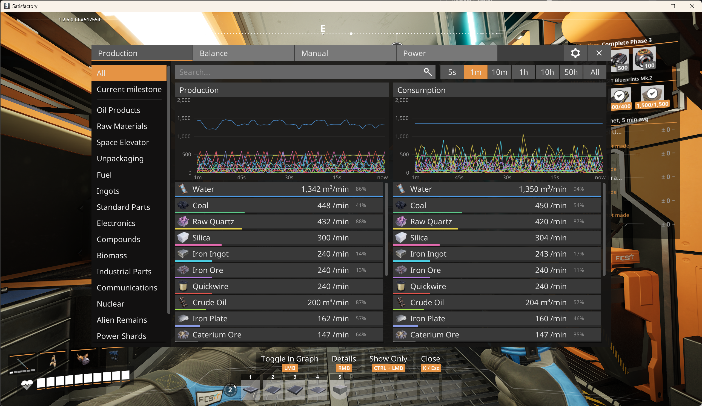
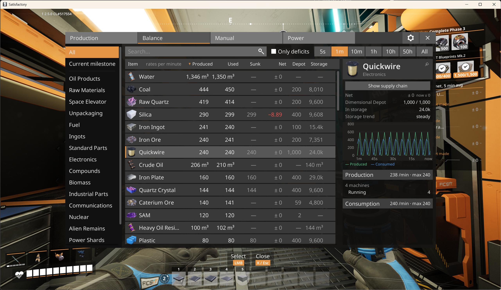
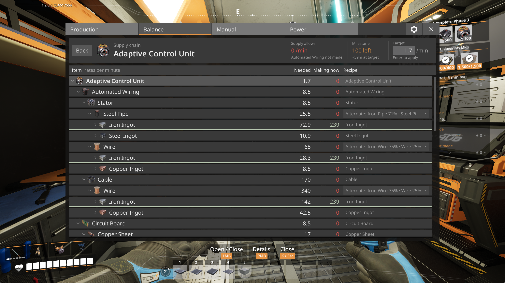
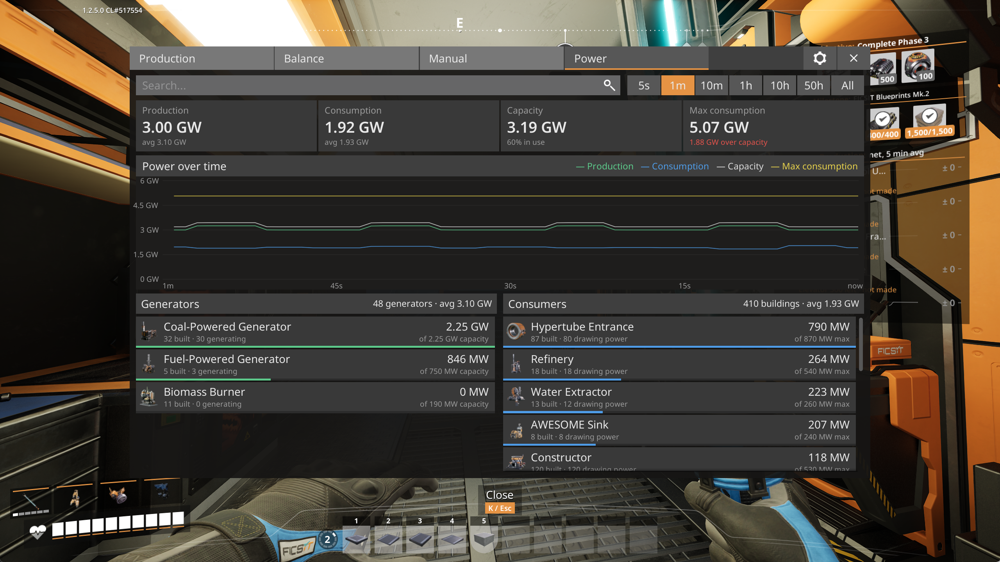

# FICSIT Statistics

FICSIT Statistics is a Satisfactory mod that shows you how fast every item in your
factory is being made and used, with history graphs, all in a window that looks like it actually came with the game.

So I really wanted something like Factorio's production stats window, but in Satisfactory's own style. There's already
other mods that covers a lot of the same data, but their UIs never really felt like part of the game to me,
so honestly the look is a big part of the point here :)

## What's in it

- **Production tab:** Production and Consumption panels sit side by side, and each one gets its own graph and a
  Depot-style item list. Every row shows the average rate over whatever range you pick (5s / 1m / 10m / 1h / 10h / 50h
  / All), the current max rate and efficiency, and a share bar in the item's graph color. Click a row to toggle it on
  the graph, or hover over it to highlight its line. The two short ranges show real counts with no smoothing at all. 5s
  is the realtime view and it redraws every frame, so each finished cycle pops up as a spike the moment it happens (host
  and single player only). 1m has one point per second. Here's what it looks like:

  

- **Balance tab:** the net rate for every item, with the worst deficit up top. There's an "Only deficits" filter and a
  Codex-style details pane. Idle items show up here too (anything sitting in the Dimensional Depot or in storage, or
  anything the mod has ever seen) with a Net of "—", and there are Depot and Storage columns. The details pane shows:
  - where the item comes from and where it ends up (manufacturing, extraction, power plants, AWESOME Sink, Space
    Elevator)
  - machine states, including why the stopped ones stopped: makers waiting on inputs or stuck with a full output, and
    users that are short on this item or on some other input (plus paused and unpowered)
  - how much is in the Dimensional Depot
  - what's in your storage containers and fluid buffers, which way that total has been heading over the last 10
    minutes, and how long it'll last if it's dropping. If it's going to run out within the Storage warning time (30 min
    by default), the item gets a red "Storage empty in" note under its name, and on the HUD too if it's pinned.
    Dimensional Depot uploaders, belts, pipes, vehicles, and machine buffers don't count toward this.
  - for Space Elevator and HUB milestone parts, how long until you've got enough for the current phase or the selected
    milestone at your current supply (you'll see this in the sidebar too, which lists the slowest part, and on the HUD)
  - a production vs consumption graph

  

  There's also a **Show supply chain** button at the top of the details pane, which opens up the whole recipe tree for
  that item. For each step you can see how much you'd need for your target rate, how much you're making right now, and
  which recipe it uses (alternates included):

  

- **Manual tab:** all the stuff you did by hand over the selected range. That's what you crafted at a Craft Bench or
  Equipment Workshop plus the ingredients it ate, what you spent on building (blueprints and upgrades included), and
  what dismantling gave back. You can sort the columns, and the details pane shows the same totals for whichever item
  you've selected. Dismantle refunds that overflow into a crate don't get counted.
- **Power tab:** production, consumption, capacity, and max consumption for the whole factory (with a warning if max
  consumption goes over capacity), plus batteries (charge, whether they're charging or draining, and how long until
  they're full or empty). There's a power-over-time graph, and generators and consumers get broken down by building
  type. The totals come straight from the game's own power circuit numbers, and any power the per-building scan can't
  pin on a specific building (e.g. electric trains and lights) gets lumped into "Other".

  

- **Sidebar:** uses the game's own item categories, plus a **Current milestone** filter for the parts the current
  Space Elevator phase still needs.
- **Pin to HUD:** pin items to a little panel under the objective panel so you can keep an eye on their net rate.
- **History is saved** right along with your game.
- **Multiplayer:** the server does all the math and sends the stats over to clients.

The default key is **K**, but you can rebind it under Options > Keybindings > FICSIT Statistics. The options live behind
the gear button next to the window's close button (changes apply right away and get saved), and you can also find them
in the Mods menu. Oh, and in the Balance tab you can click a column header (Item, Produced, Used, Sunk, Net) to sort by
it, and click it again to flip the order.

## How the rates are measured

For anyone curious about what's going on under the hood:

- **Manufacturers and extractors: real counts.** Native hooks fire when a machine grabs a cycle's ingredients and when
  it finishes a cycle, and we count the actual amounts (Somersloop boost included).
  - The counts go through a change-detecting average. As long as nothing changes, the average covers up to 10 minutes,
    so even super slow recipes read as a steady rate. When a short recent window (at least 10 s and 2 cycles) disagrees
    with it by more than normal noise, the average starts over from that point, so a machine that just stopped or just
    got built shows up within seconds.
  - Right after a save loads, we show an estimate (recipe × clock speed × measured productivity) until the first short
    window of real counts comes in.
  - That average is the "right now" number (rows, details, HUD, and estimates). The saved history behind the 10m and
    longer ranges keeps the exact counts instead, so each range is the true average over exactly that range. The only
    smoothing there is on lines drawn from its 5 s points (the 10m graphs and the HUD sparkline), and that's purely for
    looks.
- **Max rate, efficiency, and machine states:** a light scan every 5 s (one pass over the buildable list).
- **Generators:** fuel burn gets worked out from power capacity, fuel energy, and current load. That's how the game
  itself burns fuel, so it lines up with what's actually burned. Coal and nuclear plants count water too, and nuclear
  plants count waste.
- **AWESOME Sink and Space Elevator:** items get counted as they're consumed, averaged over 60 s.

On my test save (338 machines, 5,616 buildables), the scan takes about 0.7 ms every 5 s, and the hooks handle around 75
tiny counting events per second. Both numbers show up in the once-a-minute summary (`LogFicsitStatistics: Performance`).
That summary logs at Verbose so that it doesn't clog up everyone's logs. If you want to turn it on, add this to
`%LOCALAPPDATA%\FactoryGame\Saved\Config\Windows\Engine.ini` (or launch with `-LogCmds="LogFicsitStatistics Verbose"`):

```ini
[Core.Log]
LogFicsitStatistics=Verbose
```
