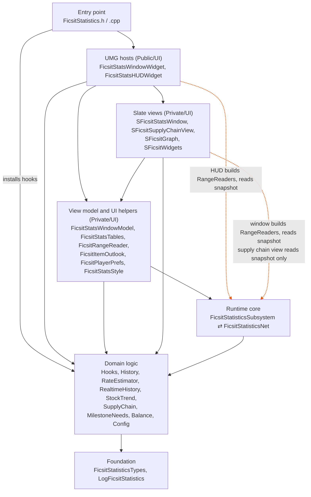
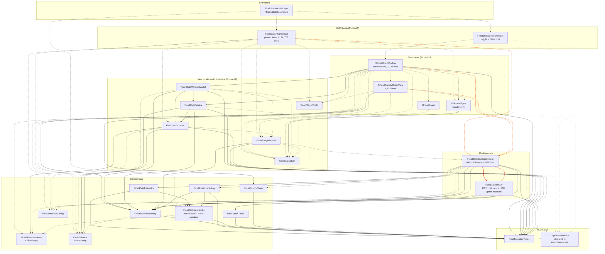

# Architecture

These diagrams show how the FicsitStatistics module fits together, starting from the module entry point in `FicsitStatistics.h`. Each box is a `.h`/`.cpp` pair (or a header-only file), and each arrow is an internal `#include`. Engine, FactoryGame, and SML includes are left out so that the mod's own structure is easier to see.

## Layer overview

## Full include graph

### Legend

- Solid arrow: the header includes the other header, so the dependency leaks to everything that includes it.
- Dashed arrow: only the `.cpp` includes the other header.
- Red: `FicsitStatisticsSubsystem` and `FicsitStatisticsNet` depend on each other.
- Orange: UI code that includes `FicsitStatisticsSubsystem.h` directly. The `FFicsitRangeReader` constructor takes an `AFicsitStatisticsSubsystem&`, so the HUD and the main window have to get the subsystem just to build a reader, and they also call getters like `GetLatestSnapshot()` on it themselves. `SFicsitSupplyChainView` skips the view model completely and only reads `GetLatestSnapshot()`.
- Grey dotted: the file only includes `FicsitStatistics.h` for the `LogFicsitStatistics` log category.

Tests aren't in the graph. The 14 test files under `Private/Tests` include the domain logic and view model headers directly (History, Net, RangeReader, WindowModel, Tables, SupplyChain, etc.) and never touch the subsystem or the Slate views.
